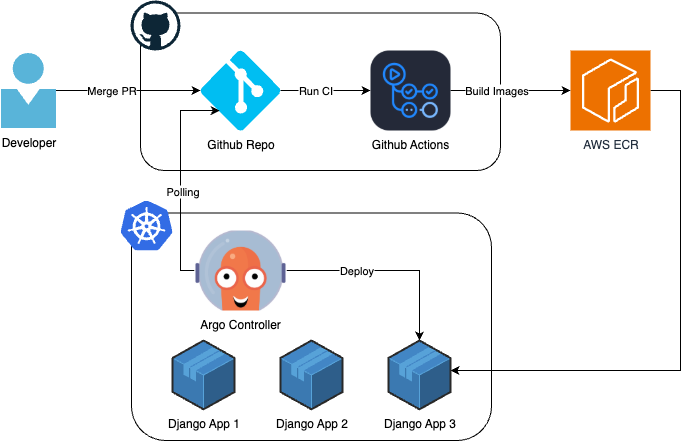

<div align="center">

# 🐦 Battle-Tested Wagtail

## **Running at Scale with Kubernetes**

### Practical deployment lessons for **Wagtail Space 2026**

**Calvin Hendryx-Parker** · CTO, **[Six Feet Up](https://sixfeetup.com/)**

[](#preview-the-slides)
[](https://wagtail.org/)
[](https://kubernetes.io/)
[](https://argo-cd.readthedocs.io/)
[](https://sli.dev/)
[](LICENSE)

<br />

> ### 🚢 Deployment shouldn't be the riskiest part of your release.
> **Repeatable infrastructure, pull-based delivery, and tooling your team can trust.**

[🎬 Talk preview](#talk-preview) · [🔄 GitOps flow](#gitops-flow) · [🗺️ Repo map](#repository-map) · [🚀 Local preview](#preview-the-slides) · [🎨 Build & export](#build-the-slides)

</div>

---

<a id="talk-preview"></a>

## 🎬 Talk preview

Wagtail runs on Django. Operating it reliably also means having a deployment process you can repeat, inspect, and recover from.

This talk explores **GitOps and Kubernetes** as tools for making releases more predictable: keep the intended state in Git, let the cluster reconcile it, and give developers a consistent starting point instead of another blank infrastructure project.

<table>
<tr>
<td width="33%" valign="top">
<h3>📚 Git as the source of truth</h3>
<p>Declarative configuration makes changes reviewable, deployment history auditable, and rollback a familiar Git operation.</p>
</td>
<td width="33%" valign="top">
<h3>☸️ Kubernetes foundations</h3>
<p>Rolling updates, self-healing, service discovery, and autoscaling provide building blocks for running applications at scale.</p>
</td>
<td width="33%" valign="top">
<h3>🔄 Argo CD reconciliation</h3>
<p>Pull-based delivery watches the desired state and reconciles the cluster, without giving the CI pipeline cluster credentials.</p>
</td>
</tr>
<tr>
<td width="33%" valign="top">
<h3>🧰 Scaf as a starting point</h3>
<p>Start with a GitOps-ready project structure and established infrastructure conventions rather than assembling every piece yourself.</p>
</td>
<td width="33%" valign="top">
<h3>❄️ Consistent tooling with Nix</h3>
<p>Reduce cross-platform surprises and keep the tools—and their versions—consistent across the team.</p>
</td>
<td width="33%" valign="top">
<h3>🚀 Confidence over ceremony</h3>
<p>Move from manual deployment steps and environment drift toward repeatable releases and a clearer recovery path.</p>
</td>
</tr>
</table>

### 🔍 A few questions we explore

- 🧭 What does GitOps change about how you operate a Django-based application?
- 🔐 Why pull deployment state into the cluster instead of pushing it from CI or a developer's laptop?
- 🩹 How do reconciliation and Git history help with drift and rollback?
- 🧩 Where do Kubernetes, Argo CD, Scaf, and Nix fit together?
- 🌱 How can a team start without mastering every Kubernetes feature first?

> 💡 **The thesis:** make the deployment process repeatable so your team can spend more energy on the application.

---

<a id="gitops-flow"></a>

## 🔄 From Git change to running application

**Review a change → build an image → publish it → reconcile the cluster.**

Git records the intended state, CI builds the application image, and Argo CD connects that desired state to the running Kubernetes workloads.

<div align="center">



</div>

The diagram comes from the original **Deploy Django** talk. Its Django application labels are retained; Wagtail builds on those same Django foundations. See [source attribution and image provenance](docs/sources/deploy-django.md).

### 🧭 The operational shift

| Instead of… | Work toward… |
|---|---|
| Manual deployment commands | Reviewed, declarative changes |
| Configuration that drifts between environments | A versioned source of truth |
| Cluster credentials distributed to deployment clients | Pull-based reconciliation inside the cluster |
| Guessing who changed a running system | An auditable Git history |
| Reconstructing the previous release by hand | A documented rollback through Git |

---

<a id="repository-map"></a>

## 🗺️ Repository map

```text
.
├── slides.md                         🎨 Presentation and speaker notes
├── public/images/deploy-django/      🖼️ Logos, GitOps diagram, and current repo QR
├── themes/sixie-purple/              💜 Reusable local Slidev theme
│   ├── example.md                   🧪 Independent layout gallery
│   ├── layouts/                     🧩 Cover, content, code, columns, and more
│   └── styles/                      ✨ Styling, fluid backgrounds, and transitions
├── tests/                           ✅ Content, media, theme, and browser checks
└── docs/sources/deploy-django.md     📚 Source attribution and adaptation notes
```

### 🔗 Useful starting points

- 🖥️ [`slides.md`](slides.md) — edit the presentation and speaker notes
- 💜 [Theme guide](themes/sixie-purple/README.md) — layouts, code sizing, backgrounds, and transitions
- 🧪 [Theme gallery](themes/sixie-purple/example.md) — isolated visual examples, separate from this talk
- 📚 [Source and adaptation notes](docs/sources/deploy-django.md) — upstream content, licenses, and image hashes
- 🧰 [Scaf project](https://sixfeetup.com/scaf) · [Scaf repository](https://github.com/sixfeetup/scaf) · [Full-stack template](https://github.com/sixfeetup/scaf-fullstack-template)

> 📝 **Work in progress:** this version starts from the 14-slide Deploy Django presentation. The title, conference, repository link, and QR code have been updated for Wagtail Space 2026; the remaining content is the foundation for further adaptation. This repository contains the presentation and theme—not a runnable Wagtail/Kubernetes demo stack or benchmark suite.

---

<a id="preview-the-slides"></a>

## 🚀 Preview the slides

### 1️⃣ Install the slide toolchain

You will need **Node.js 22.12+** and **pnpm**. The Slidev project lives at the **repository root**.

```sh
git clone https://github.com/sixfeetup/2026_WagtailSpaces_BattleTestedWagtail.git
cd 2026_WagtailSpaces_BattleTestedWagtail
pnpm install --frozen-lockfile
```

### 2️⃣ Start the presentation

```sh
pnpm run dev
```

Slidev opens the deck at <http://localhost:3030>. Edit [`slides.md`](slides.md) and the browser updates live. ✨

- 🗣️ **Presenter view:** <http://localhost:3030/presenter/1> includes speaker notes.
- ⌨️ **Navigation:** use the arrow keys to move forward and backward.
- 🌐 **Artwork:** the logos, QR, diagram, and theme artwork are bundled locally. Google Fonts use network access, with system-font fallbacks.

<details>
<summary><strong>🛠️ Preview a worktree or the theme gallery</strong></summary>

Use a different port when another checkout is already running:

```sh
pnpm exec slidev slides.md --port 3032
```

The independent theme gallery demonstrates the branded cover, dividers, code, columns, cards, and dark content:

```sh
pnpm exec slidev themes/sixie-purple/example.md --port 3031
```

Open <http://localhost:3031/1> and press **Right → Right → Left** to see sliding content and full-window background crossfades. The gallery's IAM examples are theme samples, not part of the Wagtail talk.

</details>

---

<a id="build-the-slides"></a>

## 🎨 Test, build, and export

### 1️⃣ Check the presentation

```sh
node --test tests/*.test.mjs
```

Checks cover the current talk identity, retained source content and speaker notes, repository link, image hashes, shared header gutters, transitions, and viewport isolation. The [theme guide](themes/sixie-purple/README.md#browser-regression-checks) documents the optional frame-by-frame browser regression for background continuity.

### 2️⃣ Build for production

```sh
pnpm run build
```

The static site is written to **`dist/` at the repository root**.

For GitHub Pages, build with the repository base path and publish that `dist/` directory:

```sh
pnpm run build --base /2026_WagtailSpaces_BattleTestedWagtail/
```

The GitHub Pages target URL is <https://sixfeetup.github.io/2026_WagtailSpaces_BattleTestedWagtail/> once publishing is configured.

<details>
<summary><strong>📄 Export a PDF or regenerate the repository QR</strong></summary>

PDF export requires Playwright's Chromium dependency, which is not installed by default:

```sh
pnpm add -D playwright-chromium
pnpm run export
```

To regenerate slide 2's QR code, install the `qrencode` CLI and run:

```sh
qrencode -t PNG -l M -s 10 -m 4 \
  -o public/images/deploy-django/presentation-qr.png \
  'https://github.com/sixfeetup/2026_WagtailSpaces_BattleTestedWagtail'
```

If the encoded URL or generation options change, update the QR destination and hash assertions in [`tests/deploy-django.test.mjs`](tests/deploy-django.test.mjs), along with the [image provenance](docs/sources/deploy-django.md).

</details>

---

<div align="center">

## 🐦 Build the application. Trust the delivery.

### Less deployment anxiety. More confidence in production.

Made for **Wagtail Space 2026** by **Six Feet Up**. 💜

</div>
